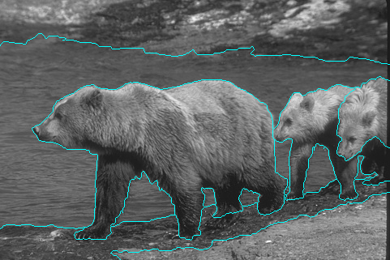
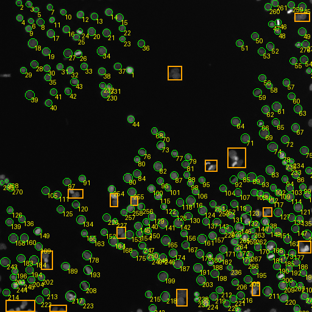

# Cần gửi Hưng ngày 09/11 — Tóm tắt Ground Truth

**Người chuẩn bị:** Đức. **Người nhận dự kiến:** Hưng. **Mục đích:** bảng và hình minh họa cho Chương 4.

File Word cùng tên đã nhúng hai ảnh: có thể gửi riêng file `.docx` mà không cần kèm thư mục ảnh.

## 1. Bảng tóm tắt

| Nhóm dữ liệu | Thông số Ground Truth | Tệp và quy ước |
| --- | --- | --- |
| BSDS500 — 10 ảnh | 5–7 người gán nhãn/ảnh; tổng 56 bộ nhãn biên/phân vùng. Giữ riêng mọi annotator. | data/gt/bsds/: .mat gốc; boundaries PNG uint8 0/255; segments TIFF uint16. |
| DRIVE — 10 ảnh | Mỗi ảnh có mask mạch máu 1st_manual và FOV mask cùng kích thước. Trắng=255, đen=0. FOV xác định vùng được phép đánh giá. | data/gt/drive/*_vessels.png và *_fov.png. FOV gốc chưa xói mòn. |
| Blob tổng hợp — 4 ảnh | 4 đối tượng/ảnh, tổng 16; tâm và bán kính từ công thức sinh ảnh, gồm cực tính bright/dark. | data/gt/blob/blob_01.json đến blob_04.json. |
| Tế bào — blob_05 | 276 đối tượng dương tính đã duyệt + 15 vùng loại trừ; ảnh 512×512, polarity=bright; READY, reviewer=Duc. | data/gt/blob/blob_05.json: objects, ignore_regions, tâm (x,y), bán kính và bbox. |

**Số người gán nhãn trên từng ảnh BSDS:** bsds_01: 6; bsds_02: 5; bsds_03: 5; bsds_04: 6; bsds_05: 7; bsds_06: 6; bsds_07: 5; bsds_08: 5; bsds_09: 6; bsds_10: 5.

Lưu ý kiểm kê BSDS: yêu cầu trao đổi nhắc khoảng 4–8 người/ảnh; riêng 10 ảnh thực nghiệm đã chọn có 5–7 người/ảnh, tổng 56 bộ nhãn. Khi mô tả bộ mẫu của nhóm, dùng con số kiểm đếm này. 56 là số bộ nhãn theo ảnh, không phải 56 người khác nhau.

**FOV DRIVE:** mask trắng là vùng quan sát hợp lệ; không chấm nền ngoài FOV. FOV gốc giữ nguyên; bước đánh giá Frangi mới xói mòn theo support kernel/scale (bộ đa tỷ lệ hiện tại dùng giao vùng hợp lệ, tương ứng 32 px). Không nhầm FOV với mask mạch máu.

**Ignore của ảnh tế bào:** 15 vùng loại trừ hiện lưu dưới dạng các hình chữ nhật trong ignore_regions của JSON, không phải 15 đối tượng âm tính và không phải một mask PNG độc lập. Khi đánh giá, dự đoán có tâm nằm trong vùng này (kể cả biên) được bỏ khỏi ghép nhãn và tính FP. Không dùng ảnh overlay màu thay cho dữ liệu GT.

## 2. Đoạn có thể đưa vào Chương 4

Bộ dữ liệu thực nghiệm gồm 25 ảnh với nhãn tham chiếu tương ứng. Với 10 ảnh BSDS500, nhóm giữ riêng toàn bộ nhãn của 5–7 người gán nhãn cho mỗi ảnh, tổng cộng 56 bộ nhãn biên/phân vùng. Với 10 ảnh DRIVE, nhãn mạch máu được dùng cùng mặt nạ trường quan sát (FOV) để giới hạn vùng đánh giá. Bốn ảnh blob tổng hợp có 16 đối tượng được xác định giải tích. Ảnh sinh học blob_05 có 276 nhân/tế bào được gán nhãn dương tính và 15 vùng loại trừ đã được Đức rà soát. Nhãn tế bào là nhãn do nhóm xây dựng, có hỗ trợ gợi ý và kiểm duyệt thủ công; không xem là nhãn chuyên gia chính thức từ nhà cung cấp dữ liệu.

## 3. Hai hình minh họa và chú thích

### BSDS500 — biên của annotator 01

Hình 4.x. Ground truth biên của ảnh bsds_01 chồng lên ảnh xám gốc. Đường cyan là biên của annotator 01; ảnh này có 6 bộ nhãn độc lập được giữ riêng. Hình minh họa một bộ nhãn, không phải hợp nhất của 6 annotator và không phải kết quả phát hiện của thuật toán.

Tệp ảnh gốc: `data/raw/bsds_01.png` (481×321); mask: `data/gt/bsds/bsds_01/annotator_01_boundaries.png`. PNG được sao chép nguyên vẹn từ preview đã kiểm tra; không đổi kích thước hay làm dày biên.

### blob_05 — tế bào và vùng ignore

Hình 4.y. Ground truth của ảnh tế bào blob_05: vòng xanh lá biểu diễn tâm/bán kính quy ước của 276 đối tượng đã duyệt; số vàng là ID đối tượng; khung cam là 15 vùng loại trừ. Các khung cam chỉ hiển thị biên vùng ignore, không phải mask phân đoạn tế bào.

Tệp ảnh gốc: `data/raw/blob_05.png` (512×512); nhãn: `data/gt/blob/blob_05.json`. Vòng tròn chỉ minh họa tâm/bán kính, không phải contour phân đoạn chính xác từng tế bào.

## 4. Cách dùng và nguồn kiểm tra

- Hưng mở DOCX bằng Word, lấy bảng và hai hình/chú thích để chèn vào Chương 4; đổi 4.x/4.y theo số hình thực tế.
- Muốn chèn PNG riêng: dùng hai file trong `ground_truth_figures/`; giữ nguyên tỷ lệ khung hình. Ảnh có độ phân giải gốc, không tăng kích thước để giả lập thêm chi tiết.
- Overlay dùng minh họa, không được dùng làm mask đầu vào tính metric. Khi tính metric, đọc nhãn/mask/JSON đã nêu.

Căn cứ kiểm kê: data/metadata/ground_truth_inventory.csv; data/gt/manifest.json; data/gt/blob/blob_05.json. Đã đối chiếu SHA-256 input và nhãn, đủ 25/25 READY tại thời điểm chuẩn bị 08/11/2026. Đây là tài liệu chuẩn bị để gửi ngày 09/11, chưa thực hiện gửi cho Hưng.
