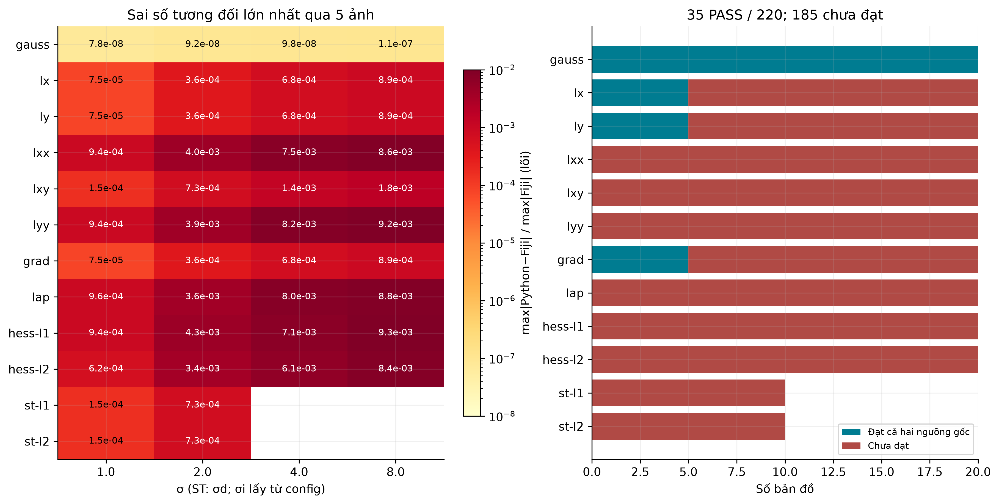
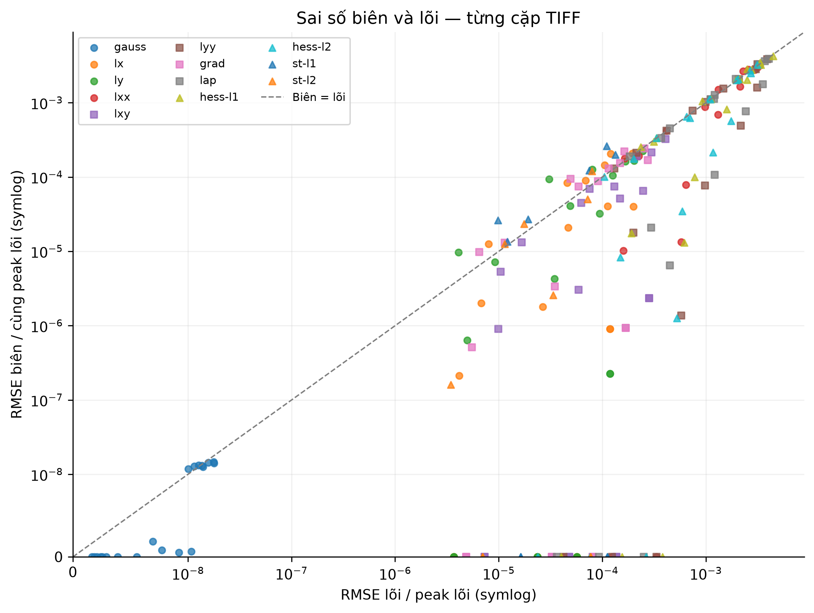
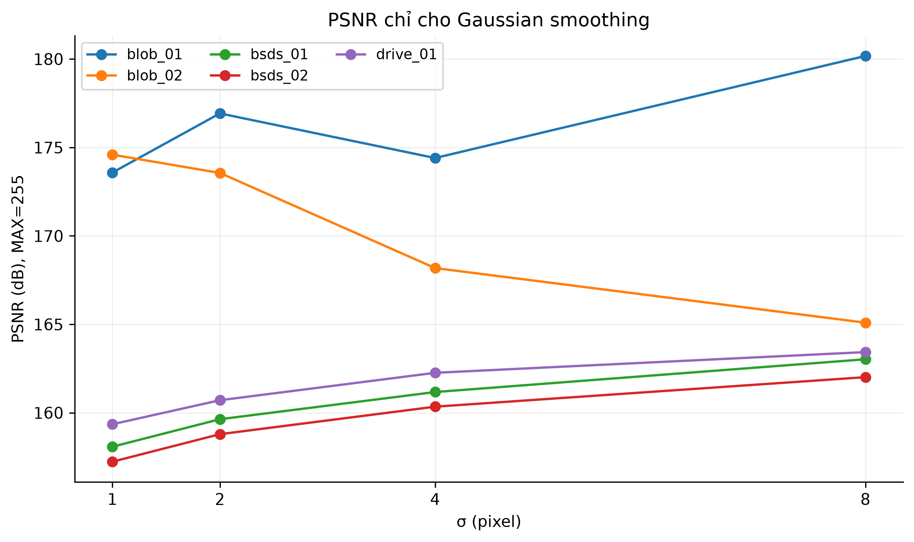
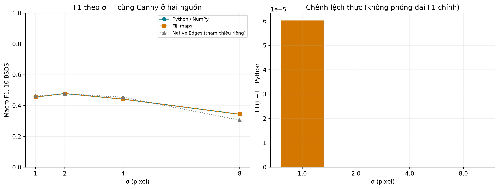
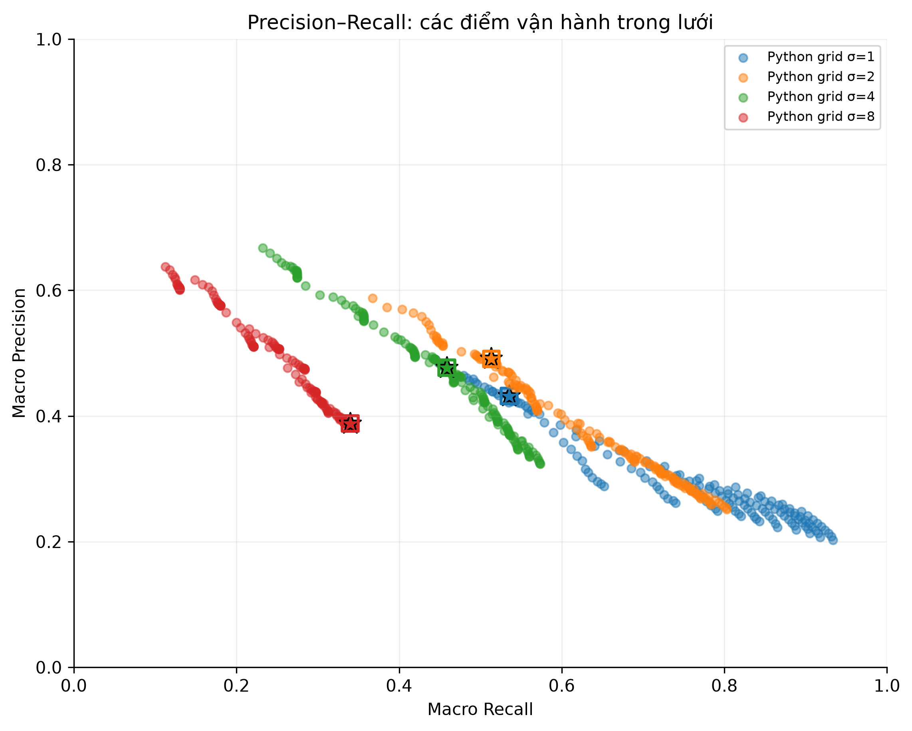
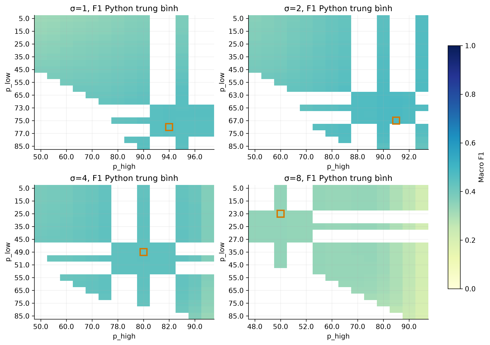
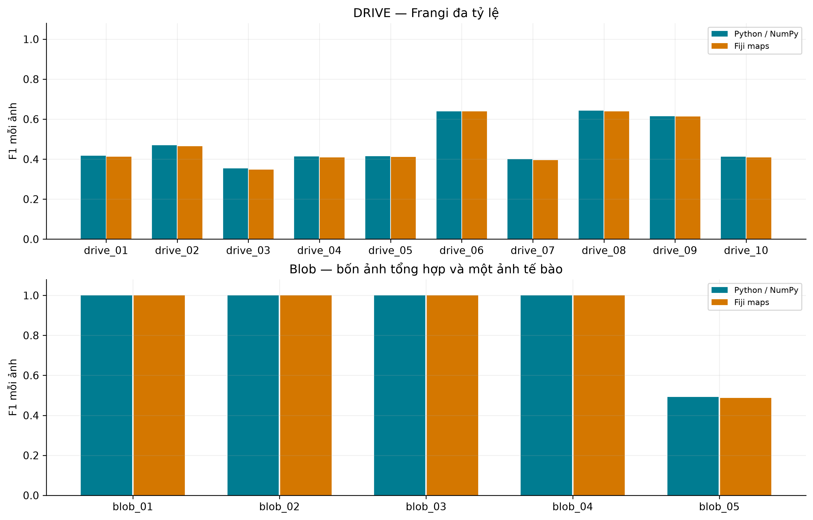
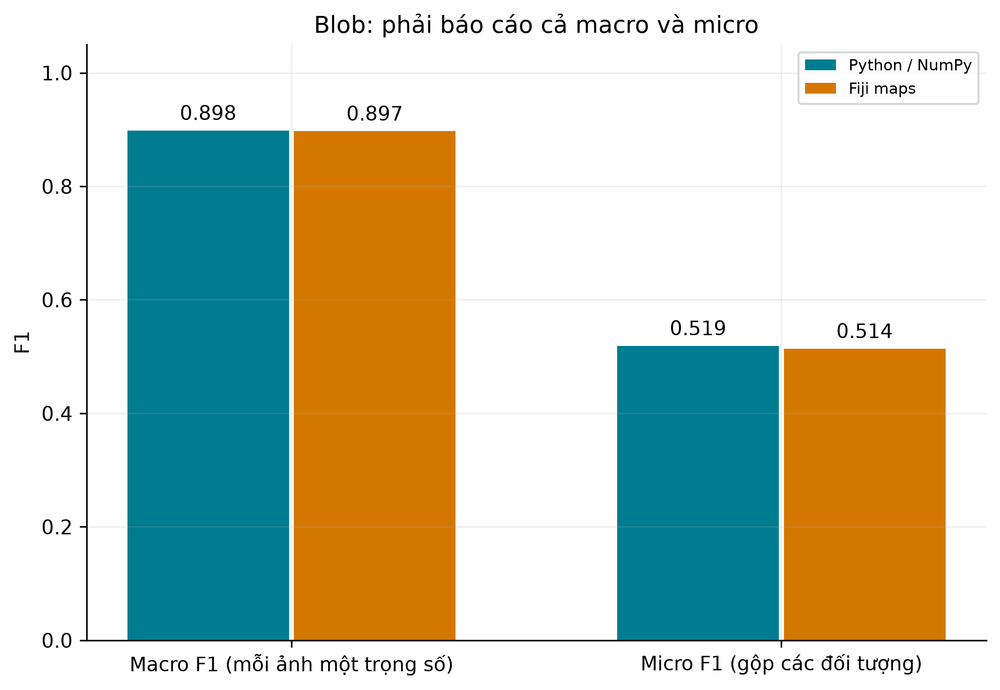
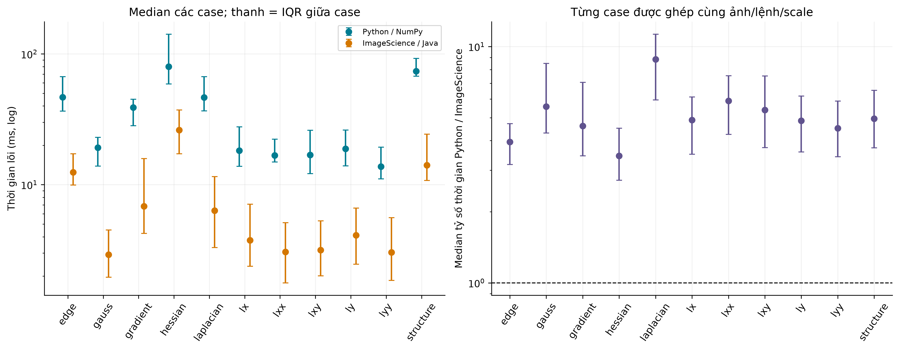
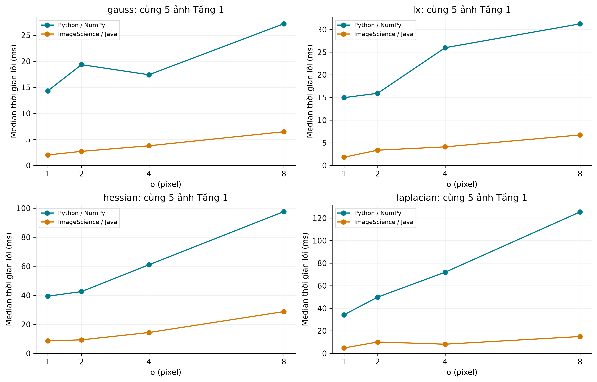

# Đức — Công việc 5: Biểu đồ và phân tích kết quả

**STT 24 trong bảng phân công, hạn 14/11.** Phiên chuẩn hóa 10/11/2026, dùng metric duc_10_11 và phép đo thời gian mới.

## 1. Dữ liệu và phương pháp

Bộ thực nghiệm gồm 10 BSDS500, 10 DRIVE và 5 blob (4 tổng hợp, 1 ảnh tế bào). Hai nguồn dùng cùng ảnh grayscale uint8, cùng scale/config và cùng detector hậu xử lý. Đầu ra công việc 4 được đọc nguyên trạng, xác minh checksum; không sửa lõi, GT, ngưỡng nghiệm thu hoặc chọn lại ngưỡng khi vẽ.

Tầng 1 đối chiếu 220 cặp TIFF trên 5 ảnh đại diện. Tầng 2 có 55 dòng mỗi nguồn: 40 BSDS theo 4 sigma, 10 DRIVE đa tỷ lệ và 5 blob đa tỷ lệ. Precision/Recall/F1 dưới đây là kết quả nội bộ trên chính tập dùng chọn ngưỡng, không phải điểm test độc lập chính thức.

## 2. Đối chuẩn số học và sai số biên

Kết quả đúng tiêu chuẩn gốc là **35/220 PASS và 185/220 chưa đạt**. Điều kiện là đồng thời relative error < 1e-4 và Pearson r > 0.9999. Chỉ Pearson cao không đủ chứng minh tương đương biên độ.

| Toán tử | Đạt / tổng | Sai số tương đối lớn nhất | Pearson nhỏ nhất |
| --- | ---: | ---: | ---: |
| gauss | 20/20 | 1.05058e-07 | 1 |
| lx | 5/20 | 0.000886618 | 1 |
| ly | 5/20 | 0.000886603 | 1 |
| lxx | 0/20 | 0.00861595 | 0.9999802649 |
| lxy | 0/20 | 0.00177401 | 1 |
| lyy | 0/20 | 0.00923981 | 0.9999677006 |
| grad | 5/20 | 0.000886636 | 1 |
| lap | 0/20 | 0.00882208 | 0.9999655272 |
| hess-l1 | 0/20 | 0.00928702 | 0.9999741936 |
| hess-l2 | 0/20 | 0.00842084 | 0.9999796385 |
| st-l1 | 0/10 | 0.000729082 | 1 |
| st-l2 | 0/10 | 0.000729113 | 1 |

Sai số tương đối lớn nhất xuất hiện ở `bsds_02`, `hess-l1`, sigma=8.0: **0.00928702**. Đây là sai số vùng lõi, vì vậy không thể quy toàn bộ khác biệt cho xử lý biên.

Gaussian cho kết quả gần nhau ở độ chính xác lưu float32; PSNR chỉ được trình bày cho Gaussian với MAX=255. Giá trị PSNR rất cao không có nghĩa toàn bộ hệ thống phát hiện đặc trưng chính xác tương ứng. Với đạo hàm/Hessian/ST, dùng sai số và Pearson theo tài liệu.

Kernel Python hiện có bước bảo toàn moment rời rạc. Khác biệt với cách rời rạc hóa/chuẩn hóa của FeatureJ là giả thuyết cần đối chiếu đáp ứng xung và phép đo hiệu chuẩn; biểu đồ không tự chứng minh đây là nguyên nhân duy nhất. Không đổi kernel chỉ để giảm số FAIL.

Hình sai số biên/lõi dùng cùng peak tham chiếu lõi trên cả hai trục. Điểm trên đường chéo cho biết RMSE biên lớn hơn lõi; mỗi điểm vẫn đại diện toán tử/ảnh/scale riêng, không gộp sai số có đơn vị khác nhau thành một MSE chung. Dùng symlog với vùng tuyến tính <=1e-8 để giữ cả sai số bằng 0/rất nhỏ, đặc biệt ở nền blob tổng hợp; không tự bỏ điểm không vẽ được trên log thông thường. Bảng `tables/border_core_comparison.csv` giữ nguyên đủ 220 điểm. Các bảng biên đã tách khỏi điều kiện nghiệm thu lõi.

## 3. Cạnh: ảnh hưởng của sigma, Precision–Recall và ngưỡng

| σ | F1 Python | F1 Fiji (cùng Canny) | Fiji − Python | Native Edges (tham chiếu) |
| ---: | ---: | ---: | ---: | ---: |
| 1 | 0.455418 | 0.455478 | +0.00006020 | 0.459929 |
| 2 | 0.477886 | 0.477886 | +0.00000000 | 0.476154 |
| 4 | 0.441491 | 0.441491 | +0.00000000 | 0.453634 |
| 8 | 0.343340 | 0.343340 | +0.00000000 | 0.305374 |

Trong bốn sigma khảo sát, Python đạt mean F1 cao nhất tại **sigma=2, F1=0.477886**. Ở sigma nhỏ, có thể giữ nhiều chi tiết/texture và tăng cạnh giả; sigma lớn làm mất cạnh yếu hoặc dịch chuyển cấu trúc mảnh. Đây là diễn giải phù hợp xu hướng quan sát, không phải chứng minh nhân quả trên mọi ảnh.

Sai khác mean F1 lớn nhất giữa hai nguồn cùng Canny là **0.00006020**. Hai đường F1 gần trùng cho thấy độ ổn định của hậu xử lý trên tập này, nhưng không thay thế điều kiện sai số nghiêm ngặt Tầng 1. Một bản đồ có thể không đạt biên độ tuyệt đối mà mặt nạ sau ngưỡng vẫn gần nhau.

Hình Precision–Recall trình bày các điểm của lưới hai ngưỡng phân vị thô và tinh. Sao là cặp chọn trên Python; ô vuông là Fiji dùng nguyên cặp ấy. Không nối thành đường PR liên tục và không suy ra AP/AUC từ lưới này. F1 tối ưu được hiểu là tốt nhất **trong lưới đã đóng băng**, không khẳng định tối ưu toàn cục.

Native FeatureJ Edges có NMS/ngưỡng riêng, được vẽ bằng đường tham chiếu riêng. Chênh lệch với Canny có thể đến từ hậu xử lý và lựa chọn ngưỡng, không được dùng để kết luận lõi vi phân của một nguồn tốt hơn nguồn kia.

## 4. Ridge và blob: ưu điểm, hạn chế thực tế

DRIVE có macro F1 **0.477382** (Python) và **0.473863** (Fiji). Python có macro precision **0.811157**, recall **0.352088**: trong protocol hiện tại, đáp ứng được giữ khá chọn lọc nhưng còn bỏ sót mạch. Khả năng mất các nhánh yếu/mảnh cần kiểm tra thêm bằng overlay trước khi khẳng định nguyên nhân.

Vùng chấm DRIVE là giao các FOV sau xói mòn theo mọi scale, support lớn nhất 32 px ở config hiện tại. Kết quả không so trực tiếp với bảng dùng FOV sigma=2 hay percentile 85 ở phiên bản cũ. Hai nguồn dùng cùng vùng và ngưỡng chọn trên Python. Biểu đồ từng ảnh cho thấy mức độ biến thiên, tránh chỉ nêu một giá trị trung bình.

Bốn ảnh blob tổng hợp đạt F1=1 ở cả hai nguồn. Với `blob_05`, F1 chỉ **0.492091** và **0.486865**. Điều này cho thấy kết quả trên hình học tổng hợp chưa đại diện đầy đủ cho dữ liệu tế bào có tương phản/kích thước đa dạng.

Blob macro F1 là **0.898418/0.897373** (Python/Fiji), trong khi micro F1 là **0.519135/0.514096**. Macro đặt mỗi ảnh cùng trọng số, nên bốn ảnh tổng hợp hoàn hảo có ảnh hưởng lớn. Micro gộp đối tượng, phản ánh rõ hơn ảnh tế bào có 276 nhãn so với chỉ 16 đối tượng tổng hợp. Cần báo cáo cả hai, không chọn riêng điểm cao.

Việc ghép blob là một-một, có cả cổng khoảng cách tâm và sai số bán kính; 15 vùng ignore được áp trước khi tính FP. Lưới vẫn đúng 7 sigma; detector hiện bỏ hai đầu scale. GT ngoài dải kích thước/cực trị hợp lệ có thể làm giảm recall. Đây là giới hạn cấu hình/phương pháp, không phải lý do loại nhãn khó khỏi báo cáo.

## 5. Thời gian chạy — đo mới trên cùng máy

Đo lại **357 case** cùng ảnh/lệnh/scale của phạm vi macro hiện tại, loại 12 case edge legacy không thuộc phạm vi này. Mỗi nguồn có 357 × (1 warm-up + 5 lần giữ lại) = **2142 mẫu**, tổng **4284 mẫu**. Mỗi case dùng median 5 mẫu sau bỏ warm-up; lưu tất cả mẫu để kiểm tra dao động.

Nguồn Java là **ImageJ 1.53k / ImageScience 3.0.0**, gọi API headless trên JVM cục bộ; không phải phép đo GUI macro. Python dùng NumPy tính float64, ImageScience dùng độ chính xác nội tại của thư viện. Đọc PNG, chuyển kiểu, clone input Java và ghi ảnh đều ngoài vùng đo. Các lệnh gradient/edge là gradient hoặc gradient+NMS, không bao gồm Canny hysteresis, Frangi hay pipeline chấm GT.

| Lệnh | Case | Median Python (ms) | Median engine (ms) | Median tỷ số từng case Python/engine |
| --- | ---: | ---: | ---: | ---: |
| edge | 40 | 46.658 | 12.442 | 3.947 |
| gauss | 20 | 19.188 | 2.916 | 5.580 |
| gradient | 20 | 38.985 | 6.828 | 4.616 |
| hessian | 56 | 80.048 | 26.168 | 3.449 |
| laplacian | 47 | 46.565 | 6.344 | 8.826 |
| lx | 52 | 18.262 | 3.764 | 4.893 |
| lxx | 20 | 16.776 | 3.064 | 5.896 |
| lxy | 20 | 16.914 | 3.167 | 5.396 |
| ly | 52 | 18.854 | 4.114 | 4.854 |
| lyy | 20 | 13.769 | 3.044 | 4.509 |
| structure | 10 | 73.889 | 14.071 | 4.950 |

Median tỷ số Python/engine trên toàn bộ 357 case là **4.710**. Tỷ số >1 nghĩa là Python mất nhiều thời gian hơn ở case đó; <1 nghĩa là ngược lại. Không gọi đây là tốc độ chung cho mọi ảnh/máy hoặc mọi lệnh. Median tỷ số từng case khác với tỷ số hai median và không được tráo hai phép tổng hợp.

Biểu đồ theo sigma giữ cùng 5 ảnh Tầng 1, tránh thay đổi số ảnh/kích thước khi tăng sigma. Python tích chập hữu hạn theo support tăng với sigma; xu hướng thời gian còn phụ thuộc số phép tích chập của từng toán tử, bộ nhớ, JVM JIT và nhiễu hệ thống. Không dùng một lần chạy để suy ra độ phức tạp tiệm cận.

Thanh IQR ở biểu đồ theo lệnh là phân bố **giữa các median case**, không phải khoảng tin cậy hay sai số chuẩn của 5 lần lặp. IQR/min/max của 5 lần đo từng case được lưu riêng. Java đo trước, Python đo sau, trong một phiên trên một máy; không kiểm soát hoàn toàn tải nền/tần số CPU. Hồ sơ môi trường và SHA-256 hai JAR nằm trong `runtime/runtime_environment.json`.

## 6. Kết luận có thể dùng trong báo cáo

Trên tập thực nghiệm nội bộ, hai nguồn tạo kết quả phát hiện khá gần nhau khi dùng chung detector/tham số. Gaussian đối chuẩn tốt; các đạo hàm và toán tử bậc cao vẫn có sai số biên độ vượt chuẩn gốc ở nhiều trường hợp dù tương quan cao. Do đó, chưa thể tuyên bố toàn bộ cài đặt tương đương số học FeatureJ.

Scale trung gian cho kết quả cạnh tốt hơn trong dãy đã khảo sát. Ridge đạt precision cao hơn recall trong protocol này. LoG hoạt động tốt trên blob tổng hợp nhưng còn hạn chế ở ảnh tế bào; micro F1 cung cấp góc nhìn thận trọng hơn macro F1. Đo thời gian cho phép mô tả đánh đổi thực thi trên máy hiện tại, không tách riêng được ảnh hưởng ngôn ngữ, precision và rời rạc hóa.

Cần phối hợp nhóm kiểm chứng kernel/chuẩn hóa bằng hiệu chuẩn trước khi chấp nhận ngưỡng nới, và dùng tập tách biệt nếu muốn đánh giá khả năng khái quát. Chưa có số liệu noise/crop mới, nên phần này không kết luận độ bền với nhiễu hay thay đổi kích thước. Các phân tích cơ chế ở trên được nêu như giả thuyết, không thay cho thí nghiệm bổ sung.

## 7. Danh mục hình để đưa vào báo cáo/slide

### 01_doi_chuan_tang1: Đối chuẩn số học Tầng 1

220 cặp; relative error <1e-4 và Pearson >0.9999. ST chỉ có hai cặp scale, ô trống không phải thiếu file.

### 02_sai_so_bien_va_loi: Sai số vùng biên

Mỗi điểm là một cặp TIFF. Cùng peak lõi trên cả hai trục; phía trên đường chéo là RMSE biên lớn hơn. Thang symlog tuyến tính gần 0 (<=1e-8), giữ cả điểm bằng 0; không bỏ các biên ảnh tổng hợp có sai số cực nhỏ.

### 03_psnr_gaussian: PSNR Gaussian

20 bản đồ Gaussian, chấm vùng lõi. PSNR cao phản ánh sai số nhỏ; không áp dụng chỉ số này cho đạo hàm có dấu.

### 04_f1_theo_sigma: Cạnh: F1 theo sigma

Canny dùng ngưỡng chọn trên Python rồi đóng băng cho Fiji tại từng σ. Native Edges có thuật toán/ngưỡng riêng.

### 05_precision_recall: Các điểm Precision–Recall

Chấm nhỏ: lưới Python; sao: cặp được chọn; ô vuông: Fiji tại cùng cặp. Đây là các điểm lưới hai ngưỡng, không phải đường PR liên tục; không tính AP/AUC.

### 06_luoi_nguong_canny: Lựa chọn ngưỡng Canny

Ô có màu là mean F1 trên 10 ảnh Python; ô trống là cặp không khảo sát/không hợp lệ, không phải F1=0. Khung cam là cặp được chọn trong lưới thô và tinh.

### 07_f1_tung_anh: Ridge và Blob: kết quả từng ảnh

Cùng ngưỡng giữa hai nguồn. F1 thấp trên blob_05 thể hiện khoảng cách từ ảnh tổng hợp tới ảnh sinh học.

### 08_blob_macro_micro: Macro và micro F1 của blob

Bốn ảnh tổng hợp có 4 đối tượng mỗi ảnh, ảnh tế bào có 276. Macro cao không đại diện cho khả năng phát hiện tế bào.

### 09_thoi_gian_theo_lenh: Thời gian chạy theo phép toán

357 case, mỗi case bỏ 1 warm-up và lấy median 5 lần đo. IQR thể hiện phân bố giữa case; trên 1 ở biểu đồ tỷ số nghĩa là Python mất nhiều thời gian hơn. Lõi ImageScience headless, không phải GUI Fiji.

### 10_thoi_gian_theo_sigma: Thời gian chạy theo sigma

Giữ cố định cùng 5 ảnh Tầng 1 cho cả bốn lệnh và mọi sigma. Mỗi điểm là median 5 case; mỗi case là median 5 lần sau warm-up.
